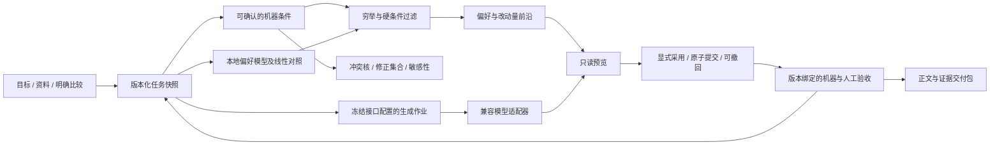

# 决策与交付架构 · product-v10

2026-10-28，Asia/Shanghai。继续原工程，全部新文件、缓存和QA数据位于D盘。

最新增量与测量见 [二维定制画布与架构评估](CONFIGURATION_CANVAS.md)：保留现栈，增加章节×版本画布、精确条件补齐计数与本地索引，不做整体语言迁移。

四步引导、需求上下文与章节内原文保留见 [四步定制体验](FOUR_STEP_EXPERIENCE.md)：使用原版本/草稿/验收链路扩展，无语言或数据库迁移。

最新的上下文灵感、内容快照绑定的需求核对与按需冻结语义查找见 [本次灵感与需求核对](CONTEXT_AND_TRACE.md)。

## 用户可以直接感受到的便利

| 实际操作 | 系统处理 | 仍由用户决定 |
|---|---|---|
| 保留喜欢的章节 | 在其他章节的现有候选中搜索可行组合 | 预览后是否采用 |
| 设置最多改动几章 | 先筛硬条件，再在改动预算内最大化当前偏好得分 | 愿意改多少，文字是否合用 |
| 条件放在一起无解 | 算出一个不可再删的冲突核，并给出有候选佐证的调整集合 | 保留条件改文字，还是明确调整条件 |
| 比较两份方案并选择理由 | 保存明确标签，显式训练本地偏好模型 | 要不要训练、采用线性还是深度版本 |
| 撤回一次比较 | 该标签停止参与训练，失配的旧模型停止用于新反馈集合 | 是否重新训练 |
| 核对并交付 | 人工确认绑定稿件版本；ZIP同时保存来源、版本与决策证据 | 事实、语义和实际使用是否通过 |
| 接入自己的模型 | 按接口分别保存模型、兼容选项与加密Key | 选择服务、手动填写模型、是否发送生成请求 |

这些是具体交互能力，没有通过真实用户试验测出节省时间或优于直接聊天的比例。

## FDE思路在这里怎样落地

本工程把FDE理解为围绕具体任务完成交付：识别问题与资料，建立可确认的边界，执行有限且可复核的操作，观察结果，再确定下一步。它体现在“交付总览”的真实状态与跳转中，而不是在界面贴职位名称。官方的闭环操作说明可参照 [Palantir AI FDE](https://www.palantir.com/docs/foundry/ai-fde/overview)；这里只借鉴执行、观察、反馈的结构，并未接入Foundry或实现其部署能力。

### 架构边界

- `ai/provider.py` 负责连接配置、按接口分隔的凭证和兼容传输。没有把供应商选择混入组合算法。
- `ai/service.py` 负责付费作业预算、冻结输入、原始响应和修改草案。接口配置在提交时固定；中途切换服务不会改变已有作业的目的地址。
- `core.py` / `ai/acceptance.py` 负责已实现的硬条件。生成模型不能自行宣布条件通过。
- `research/` / `ai/learning.py` 负责本地偏好训练、同一版本的线性对照、权重校验和失效。冻结语义编码器，没有微调上游生成模型。
- `ai/decision.py` 只接受任务、状态、完整候选排序与模型元信息，是不写数据库的确定性分析模块。
- `store.py` 保持乐观版本检查、事务与追加审计。查看、预览、拖动改动预算、分析冲突都不产生偏好标签。
- `static/decision.js` 把计算结果变成下一步操作；`refined.css` 对原界面做16px分组、间距、层级与移动布局调整。设计参考 [Apple HIG](https://developer.apple.com/design/human-interface-guidelines)，使用已有本地字体与Lucide，没有增加远程资源、毛玻璃或阴影。

## 算法的精确含义

### 有限候选空间与双目标优化

每章三个不可变版本，最多六章。固定内容在基础搜索空间中保留，其余空间最多729个组合。沿用当前推荐模块的得分精度，先执行全部锁定、原长度上限和已确认机器条件，得到可行集合F。

对组合x定义 `d(x)` 为相对当前稿件不同的非固定章节数量，`s(x)` 为当前模型得分。一个组合只有在不存在 `d(y) ≤ d(x)` 且 `s(y) ≥ s(x)`、其中至少一项严格改善的可行y时，才进入前沿。相同目标值的组合只展示一个确定性代表，返回等价数量。改动量是章节版本差异，不是时间、成本或语义距离。

界面的“最多改动k章”查询 `argmax s(x), x∈F, d(x)≤k`，得分相同优先少改动，然后按候选ID稳定打破平局。用户先预览，采用继续经过已有约束和版本检查。没有明确反馈时不能把基线或实验先验得分解释为用户偏好收益。

### 无解解释与反事实分析

每个机器条件预计算成候选通过位集，条件组合是位集交集。

1. **一个包含关系最小的冲突核**：从全部条件开始逐项尝试删除；删除后仍无解才真正移除。结果自身无解，拿掉任何一项便有解。不是保证条件数最少，也不是所有冲突核。
2. **包含关系最小的修正集合**：计算每个候选违反的条件集合，去掉严格包含另一个失败集合的集合。剩余每组都有一个候选作为见证，移除这组条件便能让该候选可行。计算全部最小集合，只返回按数量和稳定次序排列的前6组；不会改写正式条件或允许直接采用仍违规的见证。
3. **逐项移除敏感性**：仅移除一个条件，保留其他条件，精确重算新增可行组合数。计数可能重叠，不能相加；零新增也可能是条件互相遮蔽，不是证明无作用。

“精确”仅相对于当前有限候选与已实现的字面规则。日序、逐字短语、字符长度与数字原文匹配仍不是事实、工时或语义验证。

### 版本与证据

`POST /api/sessions/<sid>/decision` 需要整数revision。会话、有效标签和材料分别核对版本；结果携带正文、材料、任务、条件与状态指纹，以及排序模型信息、前沿、敏感性和修正见证。分析器与已有搜索模块的可行集合不一致时拒绝返回建议。

ZIP新增 `决策与约束证据.json`，沿用导出的最终版本检查。用户后续改稿、调整条件或更新反馈时，原快照只代表历史结果。

## 用户自接模型

在“AI设置”选择硅基流动、本机服务，或填写自定义兼容接口。输入基础地址和模型名；支持 `/models` 和 `/chat/completions`。可手动设置流式输出、JSON输出请求、是否发送temperature，以及输出上限参数名称。即使服务不提供模型列表，也可以手动填模型名后“仅保存配置”，不发送请求。

兼容传输依据 [vLLM官方服务文档](https://docs.vllm.ai/en/stable/serving/openai_compatible_server/) 和 [Ollama官方兼容说明](https://github.com/ollama/ollama/blob/main/docs/api/openai-compatibility.mdx)。本轮用真实本机HTTP测试验证了路径、参数、无Key的本机服务与非流式响应；并未调用真实第三方付费服务做新的内容验收。原生Anthropic/Gemini协议、Responses协议、图像音频、工具调用和所有供应商专用参数不在本轮适配范围内；需要兼容网关或后续适配器。

- 原 `data/private/siliconflow.json` 路径保留；只读取旧格式不会触发迁移。用户保存后按规范化基础地址保存独立配置；旧硅基流动Key不会被借给其他地址。
- Windows仍使用DPAPI；Key不进入公开配置、作业输入、浏览器持久存储或交付包。非Windows可使用对应环境变量。
- `INTENT_SILICONFLOW_API_KEY` 仅用于原地址。自定义环境Key需要 `INTENT_MODEL_API_KEY` 和精确匹配的 `INTENT_MODEL_BASE_URL`。
- 远程地址使用HTTPS，本机回环可HTTP并可无Key。拒绝携带用户名、密码、查询参数的基础地址；不跟随重定向转发凭证。
- 在运行中的作业冻结接口、模型和兼容参数，按原接口获取其凭证；没有静默跨服务回退，也没有参数不兼容时自动追加付费重试。
- 界面显示资料将发往的地址；保存和读取模型列表与实际生成分开。模型列表可达不等于模型能产出合格成品。

## 验证与保留问题

研究环境96项单元/集成检查通过；新增测试覆盖前沿与独立穷举对照、改动预算、不可再删冲突、修正见证、敏感性、版本、凭证分隔、原格式、实际HTTP和作业接口冻结。ZIP测试核对决策文件的版本、可行数和只读标记。

浏览器验证：决策总览、自定义连接、原选择定制、真实本地训练、工作室生成/修改模拟传输、验收闭环、草稿冲突、来源字库。响应布局360/390/740/820/1024/1512，16px保留；本轮真实付费请求0次。

实际运行证据 `docs/validation/product-v10-running-proof.json`：8765正式与8766隔离预览均为product-v10，原有5份会话和全部审计记录未改变；3点偏好前沿来自原训练演示的8次模拟比较，不能当真实用户效果证据。截图 `docs/screenshots/product-v10-*`。

生成内容质量的历史问题仍保留；没有把机制检查通过、机器条件通过或模型列表可达当成真实交付合格。此前深度偏好模型在合成实验总均值没有超过语义线性对照，结果见 `DEEP_LEARNING.md`，本轮没有修改历史结论。
