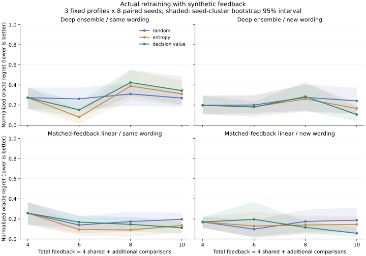

# 从条件推演到实际重训：偏好询问的闭环对照

2026-10-28。这个实验补齐了之前固定效用假设模拟的一项缺口：用户给出比较反馈后，真实系统会重新训练偏好网络，而不会只对固定假设重加权。本次直接调用线上使用的 `DeepPreferenceModel.fit()`，每轮重新拟合、重新选题、重新推荐，保留同一次训练产生的 `SemanticLinearModel` 对照。

**主要结果：决策价值策略没有在所有评价中更好，深度网络也没有超过同反馈的线性对照。** 在这组设计性模拟的新措辞测试中，决策价值选题的结果较好；在原措辞推荐中，其深度模型的平均误差反而更高。原有“固定假设内收益”不能被直接解释为神经网络真实重训的收益。

## 固定实验设计

- 3 个既有设计性偏好：具体行动、温和表达、章节搭配；8 个固定种子：101、211、307、401、503、601、701、809。不是 24 个真实用户或 24 个独立真实项目。
- 每个种子从 27 个合法组合中按独立随机排列取 24 个，三策略使用相同候选银行。24 不超过线上询问池上限，因此三策略本次都能考察银行中的全部方案对，不存在单独为某策略缩小候选池的差异。
- **先提供 4 条所有策略共有的随机反馈，再观察 0/2/4/6 次新增反馈，总量为 4/6/8/10 条。** 不可以把最终结果写成“只比较 6 次”。初始与后续比较均不重复同一无序方案对。
- 随机、回答熵、决策价值三个策略都用当前深度模型产生的预测选择下一对。每轮标签增加后从原初始化重新训练，使用全部已有标签；线性模型只作同反馈、同语义输入的推荐对照，没有单独运行线性选题策略。
- 模拟回答由设计性效用差的 logistic 概率产生，温度为 1。同一任务与种子的每个无序方案对预先分配一个随机数，三策略询问同一对时得到相同回答；换边会相应翻转答案。真值只交给回答器与外部评价器，选题函数只接收预测矩阵、已比较集合、策略与随机数生成器。
- 编码器使用本机真实、冻结的多语 MiniLM ONNX；模型原有 3 个初始化成员与 Adam 训练实现保持。每个模型每轮上限 80 步，本实验标签数小于 15 组，不启用内部验证集早停，不提供内部测试准确率。训练只用整体偏好，不额外提供“正确理由”标签。
- 4/6 条总反馈时按原实现训练最后隐藏层和输出层；8/10 条时训练两层偏好网络。每个深度成员 26,404 参数，线性对照 1,616 参数。三策略的训练调用与步数预算相同；深度三成员和单线性模型的计算量不同，不能称深度与线性等 FLOPs 对照。

运行前写入 `protocol.json`，保存源码快照与哈希。完成 72 条策略轨迹，实际执行 456 次模型拟合：24 次共有初始训练，432 次反馈后重训，共 109,440 个深度成员优化步、36,480 个线性优化步。每个策略按独立使用口径对应 7 次拟合，共享初始训练在物理运行时复用。该开发机运行约 119 秒，不是服务请求延迟或跨机器性能指标。

## 指标与结果

归一后悔值定义为 `(候选银行最大真值效用 − 推荐效用) / (最大效用 − 最小效用)`，越低越好。它来自模拟真值，不是用户耗时、事实错误率或商业损失。新措辞测试用保持设计效用标签的改写文字替换所有章节候选；这些文字不参与反馈训练，但沿用相同任务目标与组合关系。

以下为 4 条共有反馈加 6 条新增反馈，即 **10 条总反馈** 的平均归一后悔值：

| 选题策略 | 深度：原措辞 | 深度：新措辞 | 同反馈线性：原措辞 | 同反馈线性：新措辞 |
|---|---:|---:|---:|---:|
| 随机 | 0.2695 | 0.2415 | 0.1964 | 0.1873 |
| 回答熵 | 0.3110 | 0.1659 | 0.1359 | 0.1457 |
| 决策价值 | 0.3437 | 0.1055 | 0.1123 | 0.0576 |

决策价值深度模型相对基线的配对差，负值表示更低后悔值：

| 评价域与基线 | 平均差 | 种子簇 bootstrap 95% 区间 |
|---|---:|---:|
| 原措辞，相对随机 | +0.0743 | [−0.0741, +0.2445] |
| 原措辞，相对回答熵 | +0.0327 | [−0.0855, +0.1892] |
| 新措辞，相对随机 | −0.1360 | [−0.2760, −0.0182] |
| 新措辞，相对回答熵 | −0.0604 | [−0.1046, −0.0174] |

区间通过 4,000 次按种子重采样计算，每次把该种子的三种固定偏好一起保留。它描述这三个设计场景中的种子变化，只有 8 个种子簇；不是用户总体置信区间。这里有多个指标和对照，未作多重检验校正，不能据此宣称普遍优越。



还有两个可检查的发现：

1. 144 次决策价值询问中，只有 30 次具有正的预测决策价值，另 114 次按既有规则回退回答熵。没有伪造正收益；成员一致并不能证明已理解用户。
2. 总反馈从 6 到 8 条时，开放第一隐藏层与深度模型平均误差上升同时出现。这里没有额外做冻结层消融，不能把相关性当作原因；它提示应该在独立数据上检验小样本模型容量与校准问题，不能针对这份测试结果调阈值再宣称泛化提升。

## 技术说明与面试可以讨论的取舍

决策价值选题在当前三个网络成员上计算固定假设条件重加权，下一轮实际训练却会移动网络参数。两个过程并不等价。本实验保留了每次条件预测、实际反馈、重训后模型哈希与推荐结果，使这个近似的失效可以被检查。

可以准确描述为：**“实现了任务内成对偏好训练与决策价值选题，设计了匹配反馈预算、共同随机数和配对种子区间的实际重训实验，发现固定假设推演收益并不稳定迁移到训练后的推荐，因此保留线性对照和显式回退。”**

不能描述为“训练了通用大模型”“已证明优于普通对话”“提升了真实用户完成率”或“深度网络效果更好”。本轮没有付费 API、真实用户试验、上游模型微调或线上权重更新。

## 复现与证据

```powershell
$env:TEMP='D:\CodexWork\temp'
$env:TMP=$env:TEMP
$env:OPENBLAS_NUM_THREADS='1'
$env:PYTHONIOENCODING='utf-8'
.\.venv-research\Scripts\python.exe -B scripts/assess_retraining.py
.\.venv-research\Scripts\python.exe -B scripts/plot_retraining.py experiments/runs/<本次新目录>/report.json
```

脚本每次新建输出目录。完整默认运行使用 8 种子、80 步；`--seeds 1 --steps 40` 仅用于快速机制试跑，不能冒充上表复现。需先准备原研究环境和本地语义编码器；本轮没有安装依赖。绘图另需 matplotlib，缓存保存在项目 `experiments/`，生成曲线可独立导出。

本次本机原始目录：`experiments/runs/retraining-1793171384840867600/`。包含全部输入、模拟真值、公共随机数、每轮反馈、成员得分、原措辞/新措辞预测、查询分支、模型哈希、训练曲线与 0/2/4/6 新增反馈时的检查点，以及源码快照和环境记录。共有初始检查点只保存一份。`experiments/retraining-latest.json` 指向最新完成的运行。

仓库保留可公开的[数值摘要](../research/results/retraining-v1.json)、上图、实验与绘图脚本。原始权重和本机运行证据按现有规则不上传。新增 4 项测试覆盖已比较排除、全部最优值的后悔计算、种子簇配对重采样和真实训练层级/反馈哈希。正式会话、标签与已启用权重没有改变。
