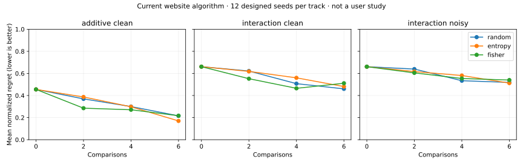

# 当前网页算法：公平对照与失效分析

2026-11-03。本次直接复用 `webcraft/preference.py` 的拟合、全部合法设计排序和24项比较池构造，对照随机、回答熵和线上默认对角Fisher启发式。不是此前文稿深度网络实验，没有调用模型API或修改正式偏好数据。

## 固定设计

三个明确设计的偏好场景：可加偏好、包含跨组件搭配奖励的偏好、同样搭配奖励加20%回答翻转。各12个预先固定种子，全部从零反馈开始，在0/2/4/6次比较后评价；共108条策略轨迹、648个模拟回答、756个评价状态。没有挑选种子或根据结果调参。

偶数种子完整6561设计；奇数种子共同保留导航布局/色调，合法设计729项。同一种子和场景的所有策略共享资料、条件、真值和预算。每条策略按自己的反馈重新拟合，因此其后续比较池可不同；池构造规则与最大规模一致，并非强制每轮内容相同。随机在当前池内的未比较对中均匀选择；回答熵选 `p(1-p)` 最大者，Fisher复用原公式。HTTP接口仍固定使用Fisher，实验参数不从客户端读取。

真值和回答器与选题器分离：选题只接收文档、保留条件、已有比较和留出对ID。每个无序设计对的翻转由seed/场景/对ID确定，策略问到同一对时得到相同回答，交换左右会翻转答案。留出64对固定设计，禁止进入查询，不暴露其答案。推荐最优值从全部合法设计真值计算；留出方向一致率相对干净真值，预测同分记0.5，真值同分排除。

指标“归一后悔值”=`(最佳真值效用−推荐效用)/(最大真值效用−最小真值效用)`，越低越好。它不是实际费用、满意度或用户耗时。额外离线拟合用于留出评价，不计为线上响应耗时。运行约44.5秒只描述本机此次实验。

## 六次比较后的结果

| 场景 | 随机后悔值 | 回答熵后悔值 | Fisher后悔值 | Fisher留出方向一致率 |
|---|---:|---:|---:|---:|
| 可加、无噪声 | 0.2157 | 0.1699 | 0.2170 | 0.6732 |
| 搭配奖励、无噪声 | 0.4602 | 0.4809 | 0.5110 | 0.5977 |
| 搭配奖励、20%翻转 | 0.5184 | 0.5122 | 0.5401 | 0.5651 |

三种策略在全部场景中均未在六次比较后精确命中全局最优。Fisher相对随机的后悔值配对差，三个场景分别为 +0.0013、+0.0508、+0.0218；12种子配对bootstrap 95%区间分别为 [−0.1104,0.1032]、[−0.0600,0.1557]、[−0.0872,0.1438]，均跨0。相对回答熵的区间也均跨0。均值较差不等于已证明统计上更差，更不能宣称Fisher优越。



## 可验证的失效点

1. Fisher每次比较平均改变约6项属性，随机约4.1–4.2项，回答熵为1项。当前启发式偏向覆盖多个特征的差异，不能据此推断更省用户精力。本实验的模拟回答不计认知负担，真实用户验证仍缺失。
2. 24维模型是可加分数，无法表达所有搭配效应。保持其他属性不变时，“舒展首屏＋紧凑项目列表”的独有奖励可产生交叉差分6；任何当前线性特征加权的对应交叉差分恒为0。单测验证此表示限制，不把它夸大为整个性能退化的唯一原因。
3. 约束、查询池、有限反馈与噪声共同影响结果；本轮未逐项消融，不能把差值全归因于某一个因素。三个固定场景和每场景12种子只能作为探索性证据，区间条件于这些设计场景，未做多重检验校正。

下一步应在独立设计任务上预先确定交互特征或控制比较改动量的消融，再考虑修改线上默认。当前保留线上策略，避免根据单份测试报告直接调参并宣称提升。

## 复现

```powershell
python -B scripts/assess_web_preference.py
python -B scripts/plot_web_preference.py experiments/runs/<新目录>/report.json
python -B -m unittest discover -s tests -p test_web_study.py -v
```

实验只用标准库；绘图额外使用已有matplotlib。配置TEMP/TMP和MPLCONFIGDIR到D盘。本次完整目录 `experiments/runs/web-preference-1793699372887779300`，包含预先写入的protocol、源码快照与哈希、所有输入、全部轨迹和报告。公开仓库保留脚本、[数值摘要](../research/results/web-preference-v1.json)与图，原始本机产物继续忽略。
